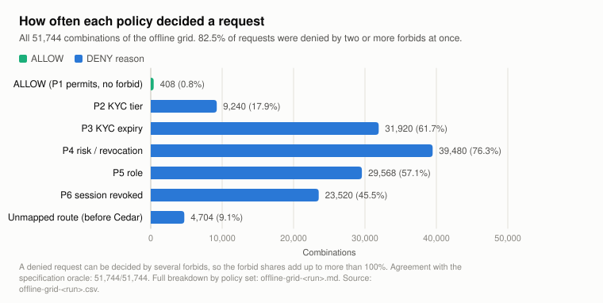
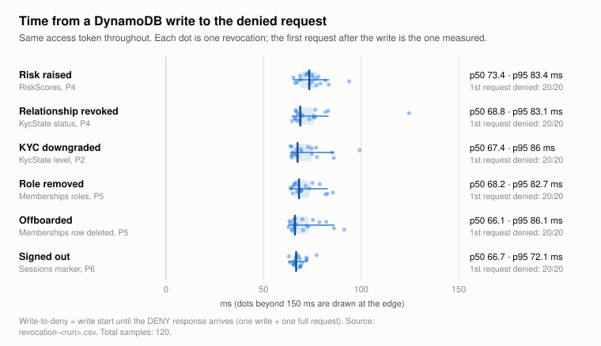
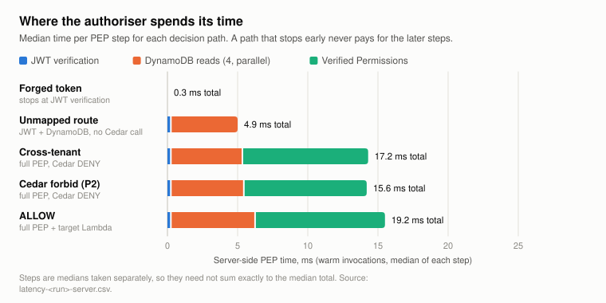
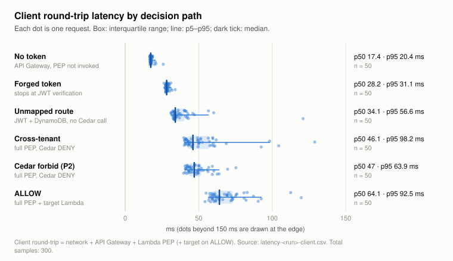
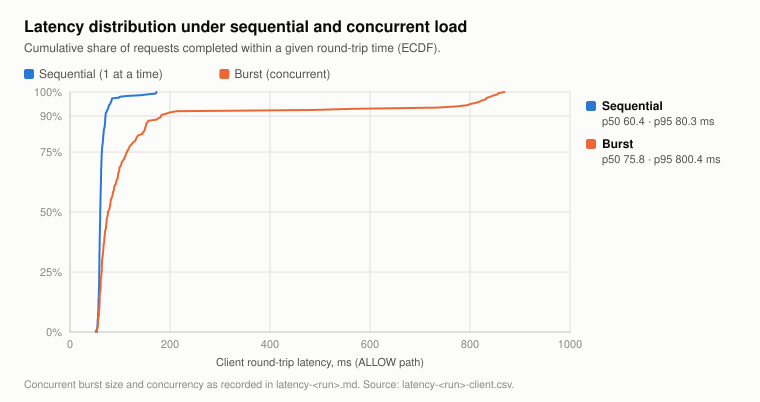
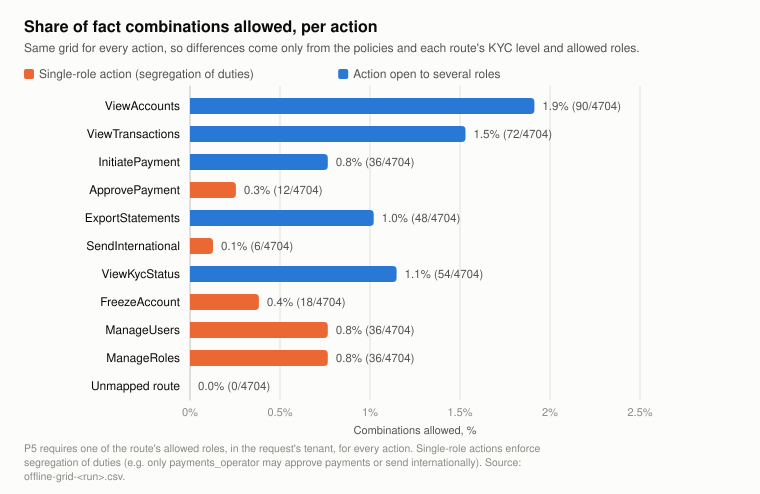

# PayVault ZTA/KYC experiment: results and analysis

**Run:** `2026-10-12T12-11-32Z` (slow suite: `2026-10-12T12-11-32Z-slow`) · **Region:** ap-southeast-2 · **Authoriser:** Lambda, 512 MB, arm64, Node.js 22, result cache **disabled** · **Policy store:** Amazon Verified Permissions (Cedar), STRICT validation, deployed policies byte-identical to the repo (`validation-2026-10-12T12-11-32Z.md`) · **Client:** developer workstation calling the public API endpoint

This run validates the **final policy set**: the paper's policies with P5 revised to cover every action and a new P6 for session revocation (README D13, D14). The earlier run `2026-10-10T11-26-01Z`, made with the paper's original P5 and no P6, is kept in `results/` as the "before" evidence. The figures are in [`figures-2026-10-12T12-11-32Z/`](figures-2026-10-12T12-11-32Z/index.html).

---

## The six policies (P1–P6)

Every request is answered by six Cedar policies stored in Amazon Verified Permissions. The authoriser Lambda verifies the user's token, reads the user's current facts for the tenant in the URL from DynamoDB, and asks Cedar to decide. Cedar denies by default. A request is allowed only if **P1 permits it and none of P2–P6 forbids it**; any single forbid wins. No policy names a route or an action: every requirement comes from the route's metadata row.

| Policy | Type | Rule in plain words | Facts it reads |
|---|---|---|---|
| **P1 Tenant isolation** | permit (the only one) | A user may act only inside a tenant they are a member of. | Memberships |
| **P2 KYC tier** | forbid | Deny if the user's KYC level **in this tenant** is below the level the route requires (e.g. payments need L2, international transfers L3). | KycState level; route's `required_kyc_level` |
| **P3 KYC expiry** | forbid | Deny if the user's KYC **in this tenant** has passed its expiry date, even if nobody has updated its status yet. | KycState `kyc_expires_at`; the current time |
| **P4 Risk / revocation** | forbid | Deny if the relationship is not `active` (revoked or expired) **or** the user's live risk score is above the route's threshold (70). | KycState status; RiskScores |
| **P5 Role** *(revised)* | forbid | Deny unless the user holds one of the route's allowed roles **in this tenant**. Applies to every action. | Memberships roles; route's `allowed_roles` |
| **P6 Session revocation** *(new)* | forbid | Deny if the access token was issued at or before the user's last sign-out. | token `iat`; Sessions `tokens_valid_after` |

When the report says a request was "decided by P4", it means P4's condition matched and Cedar reported it as the reason. "P3+P4" means both forbids matched. The exact Cedar text is in `cedar/policies/` and README §5.

**Reading guide.**
- **Case IDs** name the test suite:
  - **T**: correctness cases;
  - **S**: segregation of duties;
  - **G**: privileged actions;
  - **L**: lifecycle, where a fact changes while the user keeps the same token;
  - **A**: attacks;
  - **X**: fail-closed and session checks that run offline.

  A suffix **-ctl** marks the matching control case: same setup, one fact different, expected ALLOW.
- **p50 / p95 / p99** are percentiles. p50 is the median; p95 means 95% of requests were at least this fast.
- **Cold start**: the first request handled by a newly created Lambda instance, which pays a one-off setup cost.

---

## 1. Summary

The final design held up in every test. Every check of correctness, attack resistance, role separation and real-time revocation behaved as specified, both offline and on the deployed AWS stack, and the authoriser adds about 17 ms per request when warm.

The validation found two weaknesses in the paper's original policy set. Both are **fixed in this run**:

1. **Role gap.** The printed P5 protected `ManageUsers` only. In the "before" run an ordinary account holder reached role management, payment approval and account freezing, and any member could send international transfers. P5 now applies to every action using the roles listed for each route, and all of those requests are denied (§6).
2. **Session revocation.** Before, a token signed out in Cognito kept working until it expired (≤ 5 min). With P6, the same token is refused on the very next request, and a fresh sign-in works (§3).

| What was tested | Checks | Result |
|---|---|---|
| Hand-written cases, offline (T, S, G, X1–X5) | 46 | 46/46 |
| Fixture matrix, every user × tenant × route, offline | 429 | 429/429 |
| Combinatorial grid of fact combinations, offline | 51,744 | 51,744/51,744 agree with the specification |
| Correctness T1–T15, segregation S1–S3, privileged G1–G4 (with controls), deployed | 36 | 36/36 |
| Fixture matrix, deployed over HTTP | 429 | 429/429 |
| Lifecycle (live fact changes on one token), deployed | 7 | 7/7 |
| Attacks A1–A10, deployed | 24 | 24/24 |
| Slow attack run, incl. A4 expired-token reuse | 25 | 25/25 |
| Determining Cedar policy, from the authoriser's decision logs | 506 | 506/506 |
| Revocations repeated (6 mechanisms × 20) | 120 | 120/120 denied on the first request |
| Deployed policy store: STRICT mode, statements identical to repo | 6 policies | PASS |

"Agree with the specification" means the decision **and** the policies that made it match an independent restatement of P1–P6 (`test/support/oracle.ts`). As a check that this comparison can actually fail, a deliberate one-character error in that restatement (`>` changed to `>=` at the risk threshold) was caught at once.

One expectation in the test code was out of date during this run, and the report corrects it rather than hiding it. The offboarding case L5 expected no policy to fire, but with P5 on every action Cedar correctly names P5 (a removed member has no role). The decision was already DENY. The expectation was corrected, and L5 and the revocation benchmark were re-run under the same run id; the 506/506 result includes them.

---

## 2. Correctness: the policies do what the paper says

### 2.1 Each policy fires for the right reason

Every DENY case is paired with an ALLOW control that differs in **one fact**, so the policy under test is the only possible cause of the denial. The decision logs confirm that Cedar named the expected policy in every case:

| Case | What changes | Decided by |
|---|---|---|
| T2 | user is not a member of the tenant | P1 does not permit (P2–P5 also fire on the fail-closed values) |
| T3, T7, T9 | KYC level below the route's requirement (the user holds an allowed role) | P2 |
| T4 | KYC past its expiry date, status still `active` | P3 (the timestamp alone is enough) |
| T5, T10 | relationship `revoked` / `expired` | P4 |
| T8, T14, G1–G4, S1–S3 | caller lacks an allowed role for the route, including when they hold it in **another** tenant | P5 |
| A10, X5 | token issued before the user's sign-out | P6 |
| T11a/b | several gates fail at once | every failing forbid is reported (P2+P3+P4, P3+P4+P5) |
| T12, T13 | compliance rows missing from DynamoDB | DENY (missing data is treated as failing) |

**What we learn:** compliance state and roles really are **per relationship**. One person can be L3 in one tenant and L1 in another (T9) at the same moment, revoked in one and active in another (T5), or a payments operator in one tenant and only an account holder in another (G2 vs G2-ctl). The token cannot carry any of that, and the design never asks it to.

### 2.2 Coverage beyond hand-picked cases



The offline grid tries every combination of membership, six role sets, KYC level, KYC status, KYC expiry (past / **exactly now** / future), risk score (including **70 and 71** around the threshold), missing rows and sign-out state (never / before / **at** / after the token's issue time), for every route: 51,744 cases in total. All of them agree with the specification.

- **Deny is the overwhelming default:** 99.2% of combinations are denied, and only 0.8% (408) are allowed. A request needs *every* fact to be right.
- **Forbids usually fire together.** 82.5% of combinations are denied by two or more forbids at once. Cedar reports every forbid that matched, which gives auditors the full reason rather than the first one found.
- **Boundaries are exact.** Risk 70 is allowed and 71 denied (`>`). An expiry equal to "now" is denied (`<=`). A token issued in the same second as a sign-out is denied (`<=`). The deployed lifecycle test L1 confirms the 70/71 boundary live.

These shares describe the **test space**, not production traffic. Every combination is weighted equally, so read them as coverage, not as expected deny rates.

### 2.3 Fail-closed behaviour

| Situation | Result |
|---|---|
| Route with no metadata row (A5) | DENY before Cedar is called |
| Missing KycState / RiskScores row (T12, T13, X1, X2) | DENY |
| Member with no role at all (S2) | DENY (P5) |
| Cedar returns ALLOW together with an evaluation error (X3) | DENY |
| Misconfigured metadata makes P4 error. **Cedar on its own returns ALLOW** because an erroring forbid is skipped (X3b) | DENY, because the authoriser treats any error as a denial |
| Policy engine unavailable (X4) | DENY |

**What we learn:** X3b is the important one. In Cedar, a forbid whose condition fails to evaluate is *silently skipped*, so a broken veto turns into an ALLOW. The authoriser's "any error means deny" rule is a necessary part of the design, not just defensive coding, and the paper should state it.

The one deliberate exception is the Sessions table. A missing row there is the **normal** state (the user has never been signed out), so it lets P6 pass. Every compliance fact still fails closed.

---

## 3. Security: attack resistance and session revocation

Every attack was stopped: 24/24 rows in the main run and 25/25 in the slow run (which adds A4) matched their expected outcome. A2-ctl is the only positive control.

| Attack family | Cases | Result |
|---|---|---|
| Forged or edited tokens: injected claims, swapped identity, `alg: none`, attacker key (known and unknown key id), stripped signature, **HS256 algorithm confusion** using the pool's public key, extended expiry | A1a–h | all DENY (403) |
| Cross-tenant access and tenant confusion through headers or the query string | A2a–b | DENY |
| Replaying a captured request after revocation | A3 | ALLOW → DENY |
| Reusing a genuine token after it expires (real ~5 min wait; slow run) | A4 | ALLOW → DENY (200 → 403) |
| ID token used instead of an access token | A7 | DENY |
| Tenant id tricks in the path: case change, non-existent tenant, encoded traversal, trailing space | A8a–d | DENY |
| Header tricks: token in the query string, two tokens, Basic auth with the real password, fake identity headers | A9a–d | DENY (401/403) |
| **Using a token after the user signed out** | A10 | ALLOW → **DENY** → ALLOW with a new sign-in |
| Unmapped route; no token at all | A5, A6 | DENY (403/401) |

**What we learn:** keeping the token to **identity only** removes a whole class of attacks. A forged token never reaches the data layer, and even a valid token cannot claim a tenant, KYC level or role, because those are only read from DynamoDB for the tenant in the URL path.

### Session revocation: before and after (A10)

| Step | Cognito's view of the token | 10 Oct, before P6 | 12 Oct, with P6 |
|---|---|---|---|
| Signed in | valid | ALLOW | ALLOW (P1) |
| After sign-out | **rejected** (`NotAuthorizedException`) | **ALLOW**, until the token expires | **DENY** (P6), on the very next request |
| New sign-in | valid | — | ALLOW (P1) |

The authoriser verifies tokens offline (signature and expiry), so on its own it cannot see a Cognito sign-out. The logout path now also writes a per-user sign-out marker (`Sessions.tokens_valid_after`). The authoriser passes the token's issue time (`iat`) and that marker to Cedar, and P6 refuses any token issued at or before it. The check lives in a Cedar policy, so the authoriser still holds no authorisation rules of its own. It costs one more DynamoDB read, run in parallel with the other four.

**Caveats the paper should state:**
- **The marker must be written by the application's logout path** (or an administrator). Cognito emits no sign-out event to hook into. A token revoked only through Cognito, without the marker, still lives until it expires.
- **`iat` has one-second resolution**, so a token issued in the same second as the sign-out is also refused. A10 waits 1.5 s before signing in again.

---

## 4. Real-time revocation



Each mechanism was revoked 20 times while the user kept the same access token. The measured request is **the first one after the write**:

| Mechanism | Policy | Denied on 1st request | Access restored on undo | Write-to-deny p50 | p95 |
|---|---|---|---|---|---|
| Risk raised above threshold | P4 | 20/20 | 20/20 | 73.4 ms | 83.4 ms |
| Relationship revoked | P4 | 20/20 | 20/20 | 68.8 ms | 83.1 ms |
| KYC downgraded | P2 | 20/20 | 20/20 | 67.4 ms | 86.0 ms |
| Admin role removed | P5 | 20/20 | 20/20 | 68.2 ms | 82.7 ms |
| Offboarded (membership deleted) | P5 (no role left; P1 no longer permits) | 20/20 | 20/20 | 66.1 ms | 86.1 ms |
| **Signed out** (sign-out marker) | **P6** | 20/20 | 20/20 | 66.7 ms | 72.1 ms |

The lifecycle suite adds the cases that are not plain revocations:
- **Access granted** live: a role added takes effect on the next request (L4).
- **Reinstatement**: access returns on the same token (L6).
- **Role downgrade**: a user downgraded to a view-only role can still view, but can no longer initiate payments (L7).
- **KYC expiring by time alone**, with no write at all: denied 0.6 s after the expiry second (L3).

> **How the facts were changed.** In L1–L7, T6, A3, A10 and the revocation benchmark, every change (risk score, KYC status or level, roles, membership, sign-out marker) was written **directly to DynamoDB by the test harness**, using the experimenter's AWS credentials. It stands in for the systems that own those facts in production: the risk engine, the compliance team, a tenant administrator, or the logout handler. In particular, the `tenant_admin` role that L4 gives Alice is **not** something Alice obtains herself. The harness grants it to test that a role change applies on the next request. Through the API, Alice cannot grant it to herself: her call to role management is denied (G1, §6).

**What we learn:**
- **There is no stale window.** 120 of 120 first requests were denied. That follows from two design choices: the API Gateway authoriser cache is off, and every DynamoDB read is strongly consistent. If either were turned on, the window would equal the cache TTL or the replication delay.
- **Every kind of revocation costs the same:** about 66–73 ms from write to deny, of which the write itself is about 22 ms. "Revocation latency" is just one ordinary request.
- Single measurements can mislead. L1's first step (1,251 ms) and T6 (450 ms) were each the first request of their suite and most likely landed on a cold Lambda. The repeated benchmark gives the representative figure.

---

## 5. Performance

### 5.1 Where the time goes



Server-side, warm, 300 sequential requests on the full ALLOW path:

| Step | p50 | p95 |
|---|---|---|
| JWT verification | 0.4 ms | — |
| DynamoDB: 5 reads in parallel, strongly consistent | 6.1 ms | 16.7 ms |
| Verified Permissions `IsAuthorized` | 9.8 ms | 19.1 ms |
| **Whole authoriser** | **16.8 ms** | **32.3 ms** |

**What we learn:** the policy decision service is the largest cost, about 60% of the authoriser's time. JWT checking is negligible once the signing keys are cached. Reading the facts live on every request, now five reads including Sessions, costs about 6 ms (4.9 ms with four reads on 10 Oct). The extra read and the two extra policies (wider P5, new P6) add about 1 ms in total, within run-to-run noise.

### 5.2 Cost by decision path



| Path | Stops at | Authoriser p50 | Client p50 |
|---|---|---|---|
| No token | API Gateway (authoriser not invoked) | — | 17.4 ms |
| Forged token | JWT verification | 0.3 ms | 28.2 ms |
| Unmapped route | after DynamoDB, Cedar not called | 4.9 ms | 34.1 ms |
| Cross-tenant | full authoriser, Cedar DENY | 17.2 ms | 46.1 ms |
| Cedar forbid (P2) | full authoriser, Cedar DENY | 15.6 ms | 47.0 ms |
| ALLOW | full authoriser + protected target | 19.2 ms | 64.1 ms |

**What we learn:** the pipeline **fails fast and cheaply**. Forged tokens are rejected in 0.3 ms without touching DynamoDB or the policy engine, which limits the cost of a flood of junk tokens. Denials are cheaper than ALLOWs for the client, because the protected target never runs.

### 5.3 Load and cold starts



| Client round-trip, ALLOW path | p50 | p95 | p99 |
|---|---|---|---|
| Sequential, 300 requests | 60.4 ms | 80.3 ms | 153.9 ms |
| Burst, 200 requests at 25 concurrent | 75.8 ms | 800.4 ms | 855.2 ms |

The median barely moves under concurrency, but the tail grows tenfold. The decision logs explain why: **16 of the 200 burst requests ran on a new Lambda instance (cold start)**, and those took a median of 429.8 ms inside the authoriser (JWT 116.2 ms while the signing keys are first fetched, DynamoDB 237.1 ms while the SDK client is created and connects, Verified Permissions 76.7 ms). Warm burst requests took 26.0 ms.

**What we learn:**
- The authoriser itself scales. Warm latency under concurrency stays near the sequential figure.
- **The tail is cold starts**, a cost of serverless rather than of the authorisation model. Provisioned concurrency for the authoriser Lambda would remove it, for a standing cost.
- On warm paths, the client's extra time over the authoriser (about 44 ms at the median) is network, API Gateway, and the target on ALLOW.

### 5.4 Repeatability

The "before" run (`2026-10-10T11-26-01Z`, two days earlier, original policies) used the same benchmark settings:

| Measure | 10 Oct (original P5, no P6) | 12 Oct (final) |
|---|---|---|
| Authoriser p50, warm, sequential | 16.0 ms | 16.8 ms |
| Client p50, sequential | 62.0 ms | 60.4 ms |
| Revocations denied on 1st request | 100/100 | 120/120 |
| Write-to-deny p50, range across mechanisms | 66.5–72.9 ms | 66.1–73.4 ms |
| Cold-start authoriser p50 (burst) | 403.7 ms | 429.8 ms |

**What we learn:** medians agree within about 2 ms, and the revocation result is identical. The headline figures are stable, and the fixes did not cost measurable performance. The p95 tails vary more between runs, as expected from network and cold-start noise in samples of this size.

---

## 6. Roles: the gap and the fix



**The gap (10 Oct, paper's original P5).** P5 named `ManageUsers` only. An account holder (Alice) sent requests to ManageRoles, ApprovePayment, FreezeAccount and ViewKycStatus, and the authoriser allowed all four (HTTP 200). ManageRoles is the most serious, because it let an ordinary user reach role management, a path to making themselves an admin. In that run's grid, InitiatePayment and SendInternational were allowed for every role set, including a member with no role, so a tenant admin or compliance officer could move money. That breaks segregation of duties, the control financial regulators look for.

**First attempt (not kept).** P5 was first widened to a "Privileged" group of five actions. Its grid showed that InitiatePayment, SendInternational and ExportStatements were still open to every role, so that version was replaced.

**The fix (README D13).** P5 now applies to every action:

```cedar
forbid (principal, action, resource)
unless { context.roles.containsAny(resource.allowed_roles) };
```

Each route's `allowed_roles` comes from its metadata row, so the metadata is the system's role matrix. Changing who may call a route is a data change, not a policy change. For ManageUsers (`allowed_roles: [tenant_admin]`) this is exactly the printed P5.

**Before and after, deployed:**

| Case | Caller | Action | 10 Oct | 12 Oct |
|---|---|---|---|---|
| G1 | Alice, account_holder | ManageRoles | **ALLOW** | **DENY** (P5) |
| G1-ctl | Frank, tenant_admin | ManageRoles | — | ALLOW |
| G2 | Alice, account_holder (Aurora) | ApprovePayment | **ALLOW** | **DENY** (P5) |
| G2-ctl | Alice, payments_operator (SwiftRemit) | ApprovePayment | — | ALLOW |
| G3 | Alice, account_holder | FreezeAccount | **ALLOW** | **DENY** (P5) |
| G3-ctl | Carol, compliance_officer | FreezeAccount | — | ALLOW |
| G4 | Alice, account_holder | ViewKycStatus | **ALLOW** | **DENY** (P5) |
| G4-ctl | Carol, compliance_officer | ViewKycStatus | — | ALLOW |
| S1 | Ken, tenant_admin + compliance_officer, L3 | SendInternational | — | **DENY** (P5) |
| S1-ctl | Bob, payments_operator, L3 | SendInternational | — | ALLOW |
| S2 | Nina, member with no role | ViewAccounts | — | **DENY** (P5) |
| S3 | Frank, tenant_admin | InitiatePayment | — | **DENY** (P5) |

**In the grid**, each action is now allowed only for the roles in its metadata:

| Action | Allowed for (grid) | Roles in metadata |
|---|---|---|
| SendInternational, ApprovePayment | payments_operator only | payments_operator |
| FreezeAccount | compliance_officer only | compliance_officer |
| ManageUsers, ManageRoles | tenant_admin only | tenant_admin |
| InitiatePayment | account_holder, payments_operator | account_holder, payments_operator |
| Member with **no role** | **nothing**: none of its combinations allowed, on any route | — |

**What we learn:**
- **An ordinary user cannot elevate their own role through the API.** Role management is closed to anyone without `tenant_admin` in that tenant. A role changes only through an administrative action, as the lifecycle tests simulate (§4).
- **Segregation of duties now holds.** Only payments operators move money internationally or approve payments. Administrators and compliance officers cannot, even with full KYC.
- **Least privilege is the default.** A member whose roles are removed is denied everything, and removing a role stops the user on the next request (L7, and the "Admin role removed" revocation mechanism).
- **The metadata is now part of the security design.** The `allowed_roles` lists were first written as documentation; they now decide access, so they need the same review as the policies.

---

## 7. Deviations from the paper's printed policy set

The paper should print the policies exactly as deployed in this run:

| Deviation | Why |
|---|---|
| Types are namespaced (`PayVault::…`) | Verified Permissions rejects a schema without a namespace (D11). No policy names a type, so the policies themselves are unaffected. |
| **P5 revised**: applies to every action and reads the route's `allowed_roles` | The printed P5 left every action except ManageUsers open to any member (§6, D13). |
| **P6 added**: session revocation by sign-out marker | The printed set had no way to end a session before the token expired (§3, D14). |
| Context gains `token_iat` and `tokens_valid_after`; resources gain `allowed_roles`; a new Sessions table | Needed by P5 and P6. |

---

## 8. Limitations of this evaluation

- **Two runs, one region, one client location.** Latency includes the path from the developer workstation to ap-southeast-2. The two runs agree closely (§5.4). A client inside AWS would isolate the authoriser's cost from the network.
- **Moderate sample sizes:** 300 sequential, 200 burst, 50 per decision path, 20 per revocation mechanism. They are enough for medians and p95; the p99 values are indicative only.
- **The grid is uniform.** Its ALLOW/DENY shares describe test coverage, not real traffic.
- **The specification oracle was written by the same team as the policies.** It catches mapping and engine errors and boundary slips, but a misunderstanding shared by both would pass. Independent review of `oracle.ts` against the paper's text is recommended.
- **The role matrix is hand-written.** The tests prove each route allows exactly its listed roles. They cannot prove the lists themselves are the right business rules.
- **Session revocation depends on the logout path writing the marker.** It was written by the test harness here, standing in for a logout handler that the experiment does not include.
- **Resources are per tenant, not per object.** "Only my own account" (object-level authorisation) is out of scope.
- **Route metadata is written by hand.** Deriving it from the OpenAPI contract is future work.

---

## 9. What we learned

1. **Live facts beat token claims.** Keeping the token to identity and reading tenant, KYC, roles, risk and sign-out state live for the tenant in the URL path gave correct per-relationship decisions and immediate revocation. It also made claim-injection attacks pointless.
2. **Every kind of revocation is immediate:** risk, KYC status and level, role, membership and session, all on the very next request (120/120), at the cost of one ordinary request (about 66–73 ms end to end). The conditions are no authoriser cache and strongly consistent reads, and both must be stated as requirements.
3. **Fail-closed has to be explicit.** Cedar skips a forbid that errors. Without the authoriser's "error means deny" rule, a misconfiguration silently grants access (X3b).
4. **The validation found two design gaps, and the final policy set closes both.** The role gap (a self-elevation path and missing segregation of duties) is closed by applying P5 to every action from route data. The session gap is closed by P6. The before/after evidence is in the 10 Oct and 12 Oct runs.
5. **Generated coverage catches what hand-picked cases miss.** The first role fix passed every hand-written case. Only the grid showed that money-moving actions were still open.
6. **The overhead is small, predictable and repeatable when warm** (about 17 ms authoriser median, around 60% of it the policy engine, stable across two runs and unchanged by the fixes). The tail comes from cold starts, which is a deployment choice.

---

### Reproducing this report

```bash
export ZTA_RUN=<new id>
npm run seed
npm test && npm run test:aws && npm run bench && npm run bench:revocation
ZTA_RUN=$ZTA_RUN-slow caffeinate -i npm run test:aws:slow   # A4; keep the Mac awake for the ~5 min wait
npm run decisions -- $ZTA_RUN
npm run validate -- --deployed
npm run figures -- $ZTA_RUN
```

Source files for every table: `correctness`, `matrix`, `lifecycle`, `attacks`, `offline-policies`, `offline-matrix`, `offline-grid`, `latency`, `revocation`, `decisions` and `validation`, each with the suffix `-2026-10-12T12-11-32Z` (`.md` / `.json` / `.csv`), plus `attacks-2026-10-12T12-11-32Z-slow`.
